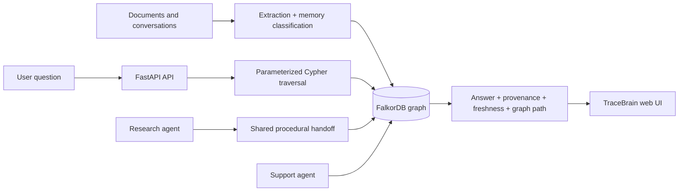
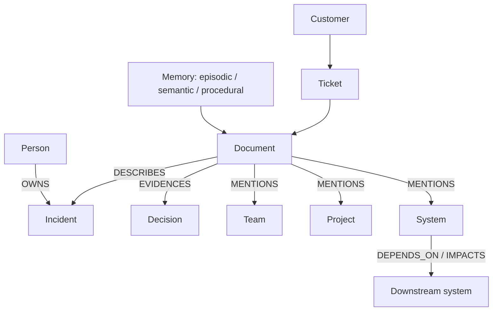

<div align="center">
  
  <h1>TraceBrain · Company Brain</h1>
  <p><strong>Trustworthy company memory powered by FalkorDB</strong></p>
  <p>
    <a href="https://tracebrain.onrender.com"></a>
    <a href="https://github.com/boss477/graphhacks/actions"></a>
    <a href="LICENSE"></a>
  </p>
</div>

<p align="center">
  <a href="#demo">README</a> ·
  <a href="#architecture">Architecture</a> ·
  <a href="#graph-data-model">Graph model</a> ·
  <a href="https://tracebrain.onrender.com">Live demo</a>
</p>

<hr />

# TraceBrain

TraceBrain is a small, synthetic company-memory assistant for Graph Hacks 2026. It uses FastAPI and FalkorDB to turn documents and conversations into a tenant-scoped, provenance-aware graph.

## Run

```bash
docker compose up --build
```

Open http://localhost:8000. The API is also documented at http://localhost:8000/docs.

FalkorDB data is persisted in the Docker volume `tracebrain_falkordb`. To connect a Slack development workspace, copy `.env.example` to `.env`, create a Slack app with the listed bot scopes, set the three Slack secrets, expose the callback URL if Slack cannot reach localhost, and open `http://localhost:8000/slack/oauth/start`. Slack Events API requests go to `POST /slack/events`; the endpoint verifies the signing secret, rejects replayed requests, handles URL verification, deduplicates `event_id`, and ingests message events.

For local development, install `requirements.txt`, start FalkorDB with `docker compose up falkordb`, then run `uvicorn app.main:app --reload`.

## Demo

### TraceBrain launch video

Watch the product walkthrough: [tracebrain_launch.mp4](assets/tracebrain_launch.mp4)

The video uses synthetic company data and demonstrates provenance-aware answers, visible graph paths, freshness, conflict warnings, and agent handoffs.

The API seeds synthetic incident documents on startup. Ask the default question or send:

```bash
curl -X POST http://localhost:8000/ask -H 'content-type: application/json' \
  -d '{"tenant_id":"acme","agent_id":"support-agent","question":"Who owns the checkout latency incident, what decision was made, and is the information current?"}'
```

The response includes a plain-language answer, owner, decision, freshness, conflict status, source documents, the exact Cypher query, and traversed graph path. The seeded Company Brain story also covers teams, projects, tickets, customers, systems, expertise, dependencies, and downstream impact paths.

## Architecture

The FastAPI service performs deterministic extraction for the synthetic demo, classifies each memory as episodic, semantic, or procedural, fingerprints documents for deduplication, and writes tenant-scoped `Document`, `Memory`, `Person`, `Incident`, and `Decision` nodes to FalkorDB. Relationships include `DESCRIBES`, `OWNS`, and `EVIDENCES`. `/ask` retrieves the newest evidence through a parameterized Cypher traversal and returns provenance plus the visible path. Conflicting owners or decisions are surfaced as a warning instead of being merged into an invented answer. Agent handoffs are stored as procedural conversation memory and shared by both agents in the tenant.

The frontend calls the JSON contract directly, renders trust signals, exposes exact Cypher, shows the graph path, and demonstrates the research-agent to support-agent handoff.

### System flow



### Company Brain graph



Every node and relationship is tenant-scoped, and every answer retains a provenance edge back to its source document.

## Graph data model

TraceBrain stores company knowledge in the `tracebrain` FalkorDB graph. Every node and relationship carries `tenant_id` so queries remain tenant-scoped.

| Node | Important properties | Relationships |
|---|---|---|
| `Document` | `id`, `title`, `text`, `source`, `updated_at`, `fingerprint` | `DESCRIBES Incident`, `EVIDENCES Decision`, `MENTIONS Team/Project/Ticket/System/Customer` |
| `Memory` | `key`, `kind`, `content`, `created_at`, `importance` | shared episodic/semantic/procedural memory |
| `Person` | `name` | `OWNS Incident`, `WORKED_ON System` |
| `Team` | `name` | owns projects and services through source evidence |
| `Project` | `name` | connected to teams and documents |
| `Ticket` | `key`, `status` | linked to customers and source documents |
| `Incident` | `key`, `name` | owned by people and described by documents |
| `Decision` | `key`, `text` | evidenced by source documents |
| `System` | `name` | `DEPENDS_ON` and `IMPACTS` other systems |
| `Customer` | `name` | linked to tickets and requests |

Representative retrieval query:

```cypher
MATCH (d:Document {tenant_id:$tenant})-[:DESCRIBES]->(i:Incident {tenant_id:$tenant})
OPTIONAL MATCH (p:Person {tenant_id:$tenant})-[:OWNS]->(i)
OPTIONAL MATCH (d)-[:EVIDENCES]->(dec:Decision {tenant_id:$tenant})
RETURN i.name, p.name, dec.text, d.title, d.updated_at, d.source
ORDER BY d.updated_at DESC
```

Representative impact traversal:

```cypher
MATCH p=(s:System {tenant_id:$tenant})-[:DEPENDS_ON|IMPACTS*1..3]->(downstream:System {tenant_id:$tenant})
RETURN p
```

The frontend displays the exact query and the returned graph path. The API tests cover tenant isolation, freshness, provenance, conflict handling, deduplication, handoff persistence, and Slack signature verification.

## Submission tracks

TraceBrain enters **Track 03 — Company Brain**. FalkorDB is load-bearing: ingestion creates graph entities and relationships, and `/ask` retrieves answers through Cypher traversal rather than using the graph only as a visualization. Shared agent memory and handoffs support the Company Brain workflow.

The Track 03 graph-insights endpoint also exposes three graph-algorithm views: native Cypher `shortestPath` for dependency explanations, FalkorDB Graph Algorithms `pageRank` for influential people and systems, and `louvain` community detection for related teams/projects/systems. When the optional algorithm procedures are unavailable in a lightweight local image, the API returns deterministic evidence-backed fallback results and preserves the exact algorithm query for deployment with the Graph Algorithms module.

## Two-minute demo script

1. Open the app and point out that the `acme` tenant has two shared agents.
2. Click **Trace answer**. Explain that TraceBrain traverses FalkorDB instead of guessing from a chat response.
3. Call out Maya Chen as owner, the connection-pooling decision, the current status, and the source documents.
4. Show the exact Cypher and visible graph path for explainability.
5. Click **Hand research to support agent**. Explain that the handoff becomes shared procedural memory.
6. Ingest a second synthetic document with a different owner or decision, ask again, and show the conflict warning.

## Attribution and disclosure

TraceBrain is an independent implementation inspired by the publicly documented concepts in [Company Brain](https://github.com/supermemoryai/company-brain) and [HippocampAI](https://github.com/rexdivakar/HippocampAI). Their source code is not included as a dependency or vendored into this repository. The application is released under Apache License 2.0; see `LICENSE`.

AI assistance was used to help draft and test portions of this hackathon MVP. The system uses synthetic data only and does not connect to Slack, production systems, or external company data.

## API

- `POST /ingest` — ingest a synthetic document or conversation
- `POST /ask` — answer a company question through Cypher traversal
- `POST /handoff` — create a durable agent-to-agent handoff
- `GET /memory?tenant_id=acme` — inspect shared episodic, semantic, and procedural memory
- `GET /health` — service and graph health
- `GET /slack/oauth/start` — begin Slack OAuth v2 installation
- `GET /slack/oauth/callback` — exchange the OAuth code server-side
- `POST /slack/events` — verify and ingest Slack Events API deliveries
- `GET /graph/insights?tenant_id=acme` — run/expose shortest-path, PageRank, and Louvain graph insights

All request models require `tenant_id`; every graph query includes tenant filtering.

